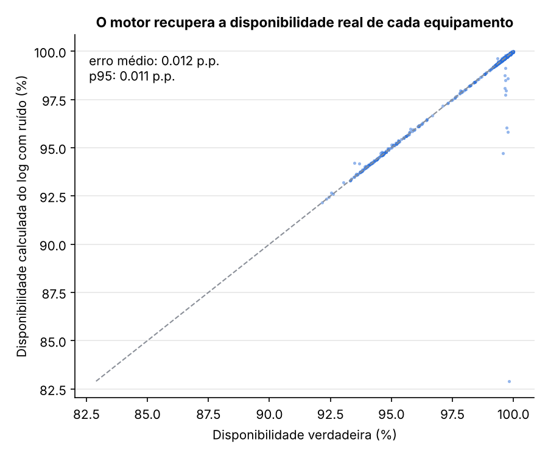
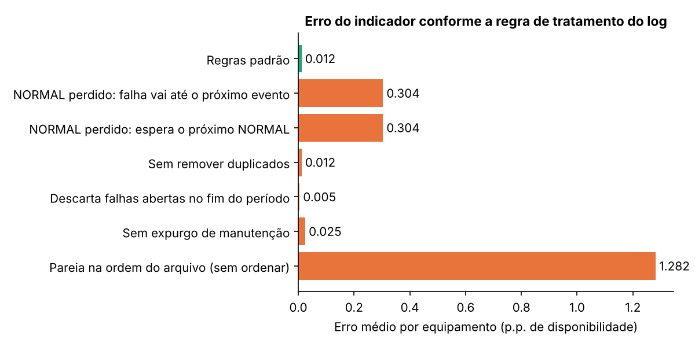
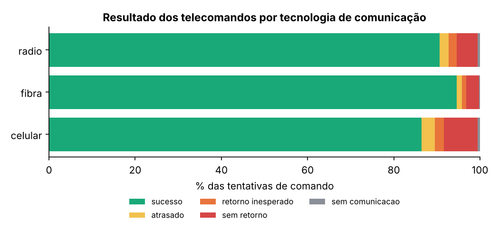
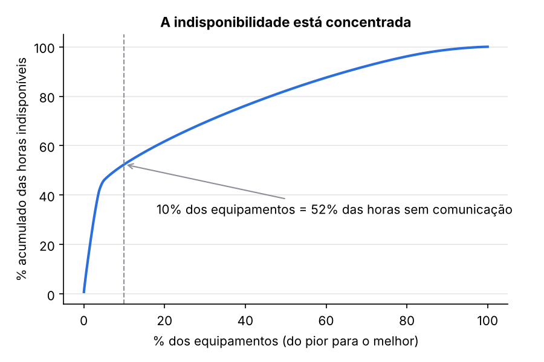
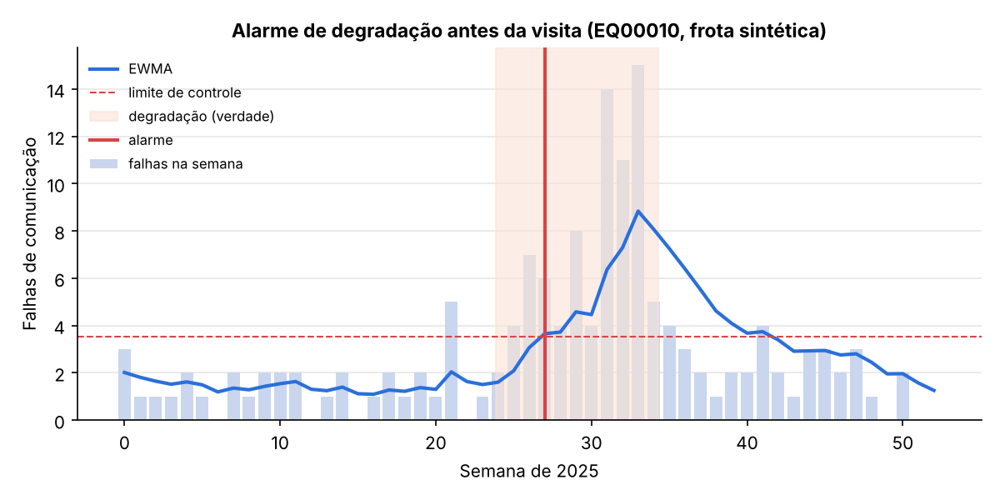
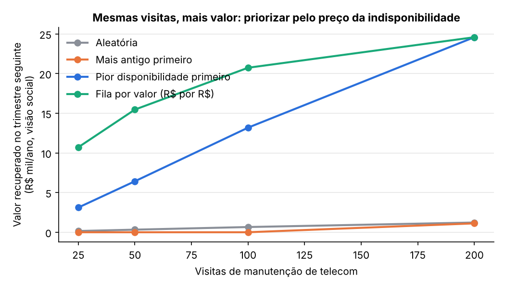

# Telemetria SCADA: disponibilidade, assertividade e fila de manutenção por valor

[](https://github.com/CaioNepomuceno2/scada-telemetry-kpis/actions/workflows/ci.yml)


**Quanto da frota de religadores e subestações está de fato comunicando, os telecomandos funcionam, e onde a
equipe de telecom deve ir primeiro?**

Biblioteca Python aberta que transforma o log de eventos do SCADA nos dois indicadores da telemetria:
* **disponibilidade da comunicação**;
* **assertividade dos telecomandos**.

A partir deles, entrega o que a gestão de ativos precisa:
* reincidentes crônicos;
* alarme de degradação antes da falha;
* concentração da indisponibilidade;
* uma **fila de manutenção priorizada pelo valor em R$ e minutos de DEC**.

O valor da indisponibilidade vem de um efeito medido em dados reais da ANEEL no projeto irmão
[automation-impact](https://github.com/CaioNepomuceno2/automation-impact).

Todos os dados aqui são **sintéticos**, gerados pelo próprio projeto com a "verdade" conhecida. Assim dá para
provar que os cálculos estão certos. O código foi escrito do zero, com conceitos públicos de SCADA e da
IEEE C37.2/ANSI (52 disjuntor, 79 religamento), e não usa dados, formatos ou nomes de nenhuma empresa.

## Resultados em uma tela

Frota sintética de **4.000 equipamentos** (2.863 religadores, 568 disjuntores, 387 chaves telecomandadas e
182 RTUs), 1 ano, **1,22 milhão de eventos** com ruído realista: duplicados, perdas, chegada fora de ordem e
relógio dessincronizado.

| | |
|---|---|
| Disponibilidade calculada × verdadeira, por equipamento (log com ruído) | erro médio de **0,012 p.p.**; frota: **−0,007 p.p.** |
| Sem ruído | erro < 1e-9 p.p.; contagem de resultados dos comandos idêntica à verdade |
| Classificação dos telecomandos (log com ruído) | **99,5%** de acerto contra a verdade |
| Erro se a falha sem "volta ao normal" for estendida até o próximo evento | **25× maior** (0,304 p.p. por equipamento) |
| Erro se os eventos forem pareados na ordem do arquivo | **100× maior** (1,28 p.p.) |
| Reincidentes crônicos identificados | precisão de **99%**, recall de **82%** |
| Degradações detectadas pelo alarme EWMA antes da visita | **78%**, com **21 dias** de antecedência mediana; a regra mensal pega 17% |
| Concentração | **10%** dos equipamentos = **52%** das horas sem comunicação |
| Fila por valor × "pior disponibilidade primeiro", 25 visitas | **3,4×** mais valor recuperado no trimestre seguinte |
| Escala | **12,2 milhões de eventos em 24 s** (2 threads, pico de 4 GB) |



## Na prática: o que muda para quem decide

### O problema hoje
* **O indicador muda conforme a planilha.** Uma falha de comunicação sem o evento de "volta ao normal" fica
  aberta até a próxima falha. Duplicados inflam a contagem de quedas. Comandos repetidos pelo operador viram
  falhas. Cada analista trata isso de um jeito, e o número da reunião depende de quem fez a planilha. Nesta
  frota, a escolha da regra muda a disponibilidade de cada equipamento em até 1,3 p.p. em média.
* **A disponibilidade não tem preço.** "98,7% este mês" não diz se vale a pena mandar uma equipe a um
  religador de rádio a 200 km. Sem preço, a fila de manutenção segue a ordem de quem reclama, ou do pior
  percentual.
* **O indicador mensal chega tarde.** A degradação de um modem ou rádio aparece primeiro como mais quedas por
  semana. Quando derruba a disponibilidade do mês, já passou boa parte do tempo útil para agir.

### O que se ganha

| ganho | quanto | de onde vem o número |
|---|---|---|
| Indicador auditável e igual para todos | erro de 0,012 p.p. contra a verdade, com regras escritas num YAML | **medido** (gerador com verdade conhecida) |
| Falhas atribuídas ao canal, não ao equipamento | assertividade de 89,5% passa a 89,9% quando se excluem os comandos enviados com o canal em falha | **medido** |
| Ação antes da falha | 78% das degradações detectadas, 21 dias antes da visita (mediana); 0,1% de alarme falso | **medido** sobre a frota sintética |
| Mais valor com as mesmas visitas | 3,4× (25 visitas) a 1,6× (100 visitas) mais valor que "pior disponibilidade primeiro" | **backtest** sintético; o valor por p.p. é **medido** no automation-impact |
| Preço da indisponibilidade | cerca de R$ 50/ano (visão social; faixa de R$ 33 a 67; só compensações, cerca de R$ 13) e 0,00026 min de DEC (faixa de 0,00018 a 0,00035) por p.p. de um equipamento médio | **medido** (projeto automation-impact, dados públicos da ANEEL) + **premissa** sobre o quanto do benefício depende de comunicação |
| Escala de produção | 12,2 milhões de eventos/ano em 24 s | **medido** (benchmark) |

### Por que aplicar
* **O telecomando depende da comunicação.** Religador sem comunicação ainda religa sozinho, mas não pode ser
  manobrado a distância. No automation-impact, cerca de 57% do efeito medido do religador sobre o CHI vem da
  redução da duração das interrupções, que é o canal que depende de operar remotamente. Cada ponto de
  indisponibilidade da frota custa de 0,7 a 1,4 min de DEC por ano.
* **A fila por valor mostra quando a visita se paga, e quando não.** Ao preço medido, só 11 dos 4.000
  equipamentos sintéticos têm valor regulatório que paga uma visita em até 3 anos. A fila põe esses primeiro e
  deixa explícito que o resto depende de outros motivos: segurança de manobra, automação futura, obrigação de
  supervisão.
* **Defesa do orçamento de telecom.** A mesma conta vale para propor metas de disponibilidade. Subir a frota de
  95% para 99% vale de 3 a 6 min de DEC por ano, segundo o automation-impact.

### Como aplicar (roteiro de adoção)
1. **Conectar o histórico.** Exportar do SCADA/ADMS os eventos de falha e retorno de comunicação, os comandos e
   os estados dos religadores e disjuntores (CSV ou Parquet). Gravar em Parquet particionado por mês.
2. **Mapear os pontos.** Reescrever o `mapeamento` do YAML com os nomes de ponto e estado do sistema. Cadastrar
   a dimensão de equipamentos (subestação, regional, tecnologia de comunicação, clientes a jusante) e as janelas
   de manutenção programada.
3. **Validar contra o indicador oficial por 1 a 2 meses.** Rodar em paralelo e explicar cada diferença por uma
   regra (duplicados, falhas abertas, expurgo). Ajustar o YAML até as diferenças restantes serem decisões
   conscientes.
4. **Calibrar o valor.** Trocar o valor por p.p. pelo da própria empresa, usando o método do automation-impact,
   e os custos de visita pelos reais. Trocar `clientes_jusante` pelo CHI dependente de cada religador.
5. **Publicar.** `telemetry-kpis calcular` gera o modelo estrela para o Power BI (seção abaixo). Rodar todo dia
   ou toda semana, com a fila e os alarmes de degradação indo para a equipe de telecom.
6. **Medir o piloto.** Durante 2 a 3 meses, seguir a fila numa regional e comparar com outra que mantém a rotina
   atual. Medir a disponibilidade recuperada por visita e a assertividade dos comandos.

### Limites de uso
* **Os números de frota, tecnologia e estratégia são da frota sintética.** Mostram que o método funciona e como
  as regras pesam, não como está alguma frota real.
* **O valor por p.p. é um efeito médio**, medido para religadores em uma distribuidora. Não use como valor
  exato de um equipamento específico.
* **Falhas abertas no fim do período** podem ser falha real em curso ou "volta ao normal" perdida. O motor
  marca as duas (`fim_tipo`). Confira as mais longas antes de cobrar alguém por elas.

## 1. O motor recupera a verdade

O gerador cria a frota, o que de fato aconteceu com cada canal de comunicação e cada comando, e um log com o
ruído típico de um SCADA. O motor só vê o log.

| | sem ruído | com ruído |
|---|---|---|
| Erro da disponibilidade da frota | < 1e-12 p.p. | −0,007 p.p. |
| Erro médio por equipamento | < 1e-11 p.p. | 0,012 p.p. |
| Erro p95 por equipamento | < 1e-10 p.p. | 0,011 p.p. |
| Acerto da classificação dos comandos | 100,0% | 99,5% |
| Assertividade da frota (calculada × verdadeira) | igual | 89,45% × 89,88% |

**O que isso significa:**
* **O que sobra de erro vem de informação que se perdeu no log.** É o caso de um "volta ao normal" que não
  chegou: a falha fica aberta até o fim do ano. Por isso o erro máximo de um equipamento é 16,9 p.p.
* **A assertividade calculada fica 0,4 p.p. abaixo da real** porque algumas respostas de estado se perderam e
  aparecem como "sem retorno".

## 2. As regras que mudam o indicador



| Mesma base com ruído, regra alterada | Erro médio por equipamento | Erro da frota | Erro na contagem de falhas |
|---|---|---|---|
| **Regras padrão** | **0,012 p.p.** | −0,007 p.p. | −0,3% |
| "Volta ao normal" perdida: falha vai até o próximo evento | 0,304 p.p. | −0,302 p.p. | −0,3% |
| "Volta ao normal" perdida: espera o próximo NORMAL | 0,304 p.p. | −0,302 p.p. | −0,6% |
| Sem remover duplicados | 0,012 p.p. | −0,007 p.p. | **+1,7%** |
| Descarta falhas abertas no fim do período | 0,005 p.p. | +0,000 p.p. | −0,3% |
| Sem expurgo de manutenção | 0,025 p.p. | −0,021 p.p. | −0,3% |
| Pareia na ordem do arquivo, sem ordenar | **1,28 p.p.** | −1,28 p.p. | −0,2% |

**O que isso significa:**
* **A regra mais importante é o que fazer quando o "volta ao normal" se perde.** Estender a falha até o próximo
  evento infla a indisponibilidade 25 vezes mais do que imputar a duração típica do próprio equipamento.
* **Duplicados não mudam as horas, mas inflam a contagem de quedas.** Isso pesa no indicador de flapping.
* **Descartar as falhas abertas no fim do período reduz o erro aqui, mas o padrão continua contando essas
  falhas.** Uma falha em curso é real, e descartá-la esconderia justamente o equipamento parado há semanas. O
  certo é revisar a lista de abertas (`fim_tipo = 'aberto'`).

| Assertividade, regra alterada | Calculada | Verdadeira | Erro |
|---|---|---|---|
| **Regras padrão** | 89,5% | 89,9% | −0,4 p.p. |
| Conta cada repetição do operador como um comando | 86,6% | 89,9% | −3,3 p.p. |
| Sem tolerância de 2 s para o relógio do equipamento | 86,8% | 89,9% | −3,1 p.p. |
| Tempo limite de 10 s em vez de 30 s | 83,0% | 89,9% | −6,9 p.p. |

## 3. O que os indicadores mostram (frota sintética)



| Tecnologia | Equipamentos | Disponibilidade | Assertividade | Assertividade excluindo o canal em falha |
|---|---|---|---|---|
| Fibra | 905 | 99,78% | 94,6% | 94,8% |
| Rádio | 1.434 | 99,43% | 90,6% | 91,1% |
| Celular | 1.661 | 99,44% | 86,4% | 86,9% |

* Tempo de resposta dos comandos bem-sucedidos: p50 de 4,2 s e p95 de 11,1 s.
* 5,8% dos comandos ficam sem retorno, 2,4% chegam atrasados, 1,8% têm retorno inesperado e 0,5% são enviados
  com o canal em falha.
* Essas diferenças entre tecnologias são as **premissas do gerador**, que o motor recuperou. Numa frota real, é
  isso que a tabela mostraria.

## 4. Analítica para gestão de ativos

**Reincidentes e flapping.**
* A regra de crônico (abaixo de 98% em 3 dos últimos 4 meses) sinalizou 147 equipamentos: 99% deles são de fato
  problemáticos, e foram encontrados 82% dos 178 problemáticos.
* A regra de flapping achou os 81 equipamentos com oscilação, sem nenhum falso positivo. O padrão sintético é
  bem marcado; em dados reais, espere menos.

**Concentração.**



1% dos equipamentos responde por 14% das horas sem comunicação, 5% por 46% e 10% por 52%. Nas subestações a
concentração é menor: as 10% piores somam 19% das horas. O problema está em equipamentos específicos, não em
subestações inteiras.

**Degradação antes da falha.**



| 157 equipamentos que degradaram até uma visita | Alarme EWMA semanal | Regra mensal (abaixo da meta no fim do mês) |
|---|---|---|
| Detectados antes da visita | **78%** | 17% |
| Antecedência mediana | **21 dias** | 13 dias |
| Alarme falso nos equipamentos normais (41 semanas) | 0,1% | — |

A carta EWMA olha para o **número de quedas por semana**, e não para as horas. É aí que a degradação de um
rádio ou modem aparece primeiro.

## 5. Fila de manutenção priorizada por valor



A fila foi montada com os dados calculados de janeiro a setembro, e o ganho foi medido no que de fato aconteceu
de outubro a dezembro:

| Visitas | Fila por valor | Pior disponibilidade primeiro | Mais antigo primeiro | Aleatória |
|---|---|---|---|---|
| 25 | **R$ 10,7 mil/ano** | R$ 3,1 mil | R$ 0 | R$ 0,2 mil |
| 50 | **R$ 15,5 mil** | R$ 6,4 mil | R$ 0 | R$ 0,3 mil |
| 100 | **R$ 20,7 mil** | R$ 13,2 mil | R$ 0 | R$ 0,7 mil |
| 200 | R$ 24,6 mil | R$ 24,6 mil | R$ 1,1 mil | R$ 1,2 mil |

**O que isso significa:**
* **Com poucas visitas, a fila por valor recupera 3,4 vezes mais que atacar o pior percentual.** Ela pesa
  quantos clientes dependem do equipamento e quanto custa a visita. O primeiro da fila é um disjuntor com 95,4%
  de disponibilidade e 19,7 mil clientes a jusante, à frente de religadores com disponibilidade pior e poucos
  clientes.
* **Com 200 visitas, as duas regras se encontram**, porque já cobrem quase todos os equipamentos com problema.
* **Idade não explica a indisponibilidade nesta frota.** Por construção do gerador, o efeito da idade é pequeno.
* **Os valores absolutos são pequenos, e isso é um resultado.** Ao preço medido no automation-impact, cerca de
  R$ 50 por p.p. por equipamento médio por ano, os 25 primeiros da fila valem R$ 10,7 mil/ano para R$ 27,9 mil
  de visitas (payback de 2,6 anos), e só 11 equipamentos se pagam em até 3 anos.
* **A conta regulatória sozinha justifica poucas visitas.** O resto da manutenção de telecom precisa ser
  defendido por outros motivos (segurança de manobra, automação, obrigação de supervisão), e a fila deixa isso
  explícito.

## 6. Escala

[`scripts/benchmark.py`](scripts/benchmark.py), com 40.000 equipamentos e 1 ano, numa máquina de 4 vCPUs
(DuckDB com 2 threads e limite de 4 GB):

| Etapa | Tempo |
|---|---|
| Ler 12,15 milhões de eventos (204 MB em Parquet particionado) e normalizar | 1,5 s |
| Parear 3,3 milhões de falhas de comunicação | 5,0 s |
| Disponibilidade diária (14,6 milhões de linhas equipamento × dia) | 8,5 s |
| Disponibilidade mensal | 2,7 s |
| Assertividade (1,26 milhão de tentativas, ASOF join) | 6,5 s |
| **Total do motor** | **24 s (cerca de 500 mil eventos/s), pico de 4,1 GB** |

## Como usar

```bash
pip install -e ".[dev]"
```

```bash
telemetry-kpis gerar --equipamentos 2000 --saida dados/
```

```bash
telemetry-kpis calcular --log dados/log --equipamentos dados/dim_equipamento.parquet --manutencao dados/manutencao.parquet --inicio 2025-01-01 --fim 2026-01-01 --saida saida/
```

```bash
telemetry-kpis analisar --dados saida/
```

```bash
telemetry-kpis fila --dados saida/ --meses 3 --top 100 --saida fila.csv
```

Em Python:

```python
from telemetry_kpis import config
from telemetry_kpis.motor import Motor

m = Motor(config.carregar("minha_config.yaml"))
m.carregar_log("historico_scada/")            # Parquet: timestamp, equipamento, ponto, estado
m.carregar_equipamentos("equipamentos.parquet")
m.carregar_manutencao("manutencao.parquet")
m.intervalos("2025-01-01", "2026-01-01")
m.diario(); m.mensal(); m.comandos()
m.disponibilidade_agregada("subestacao", mensal=True)
m.assertividade_agregada(["tecnologia", "familia"])
```

**Configuração.** Todas as regras estão em
[`config_padrao.yaml`](src/telemetry_kpis/config_padrao.yaml): o mapeamento dos pontos, as janelas de duplicado
e de repetição, o tempo limite, a tolerância de relógio, o tratamento de falhas abertas e perdidas, o expurgo, as
regras de crônico, de flapping e do EWMA, e os parâmetros de valor.

**Power BI.** `calcular` exporta um modelo estrela em Parquet:
* dimensões: `dim_equipamento`, `dim_subestacao` e `dim_tempo`;
* fatos: `fato_disponibilidade_diaria`, `fato_disponibilidade_mensal`, `fato_falha_comunicacao` e
  `fato_comando`.

Há uma amostra pronta em [`exemplos/powerbi/`](exemplos/powerbi/). As relações e a medida DAX de
disponibilidade ponderada pelo tempo estão em [`docs/metodologia.md`](docs/metodologia.md#7-modelo-de-dados-power-bi).

**Painel.**

```bash
pip install -e ".[app]"
```

```bash
streamlit run app/app.py -- --dados exemplos/powerbi
```

## Metodologia

[`docs/metodologia.md`](docs/metodologia.md) traz:
* as regras de pareamento, de divisão por dia e de expurgo;
* a classificação dos comandos;
* as fórmulas da analítica e da fila;
* a tabela completa de premissas do gerador;
* o desenho da validação.

## Reproduzir

```bash
pip install -e ".[dev]"
```

```bash
pytest
```

```bash
python scripts/estudo.py
```

```bash
python scripts/benchmark.py --equipamentos 40000 --threads 2 --memoria 4GB
```

`scripts/estudo.py` gera `reports/*.csv`, `reports/resultados.json`, as figuras e a amostra do Power BI, em
cerca de 35 s. `scripts/benchmark.py` grava `reports/benchmark.json`.

## Limitações
* **Dados sintéticos.** O gerador tem premissas simples: falhas Poisson independentes, sem eventos regionais
  como tempestades ou queda de uma operadora celular, que derrubam muitos equipamentos ao mesmo tempo. A
  validação prova o cálculo, não o comportamento de uma frota real.
* **Valor por p.p.** Vem de um efeito médio medido para religadores no projeto automation-impact, com dados públicos da ANEEL, e de uma premissa sobre a
  fração do benefício que depende de comunicação. O peso por clientes a jusante é um proxy. **Essa fração é a parte frágil:** ela vem do canal da duração, que no projeto automation-impact vale 57% do efeito no TWFE, 86% no estimador de Callaway & Sant'Anna e 17% se a tendência anterior da duração continuar. Por isso o preço por p.p. deve ser lido como ordem de grandeza, não como medida precisa.
* **Custos de visita e probabilidade de sucesso do reparo** são ilustrativos.
* **Expurgo de manutenção** supõe janelas sem sobreposição no mesmo equipamento.
* **Retorno inesperado** só considera estados da mesma família. Um estado espontâneo da proteção que chega logo
  depois de um comando pode ser lido como retorno do comando.
* **EWMA:** o limite usa a aproximação normal com piso de taxa. Com contagens muito baixas, a calibração do
  alarme falso deve ser conferida nos dados reais.

## Projetos relacionados
* [automation-impact](https://github.com/CaioNepomuceno2/automation-impact): quanto DEC um religador evita e
  quanto custa cada ponto de indisponibilidade da telemetria, com dados da ANEEL.
* [distribution-asset-risk](https://github.com/CaioNepomuceno2/distribution-asset-risk): onde investir primeiro
  para reduzir DEC, FEC e compensações.

---
Autor: **Caio Nepomuceno**. Projeto independente, com dados sintéticos e sem vínculo com qualquer
distribuidora.
